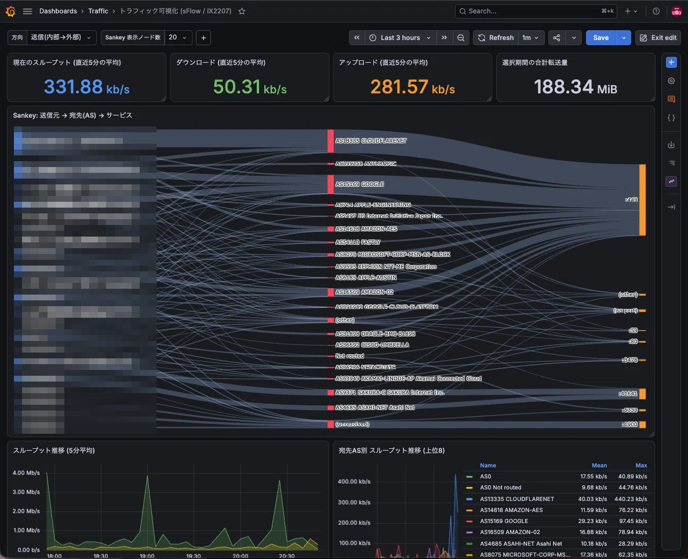

# ix-sflow-grafana

NEC UNIVERGE IX シリーズの **sFlow v5** を収集し、PostgreSQL を経由して
Grafana で可視化する自己完結した構成です。Akvorado 相当の見た目を、
Raspberry Pi 4 クラスの小型機器で動く軽量な構成で実現します。

- **Sankey 図** — 送信元 → 宛先 AS → サービスポート
- **AS 別の積み上げ面グラフ** — Akvorado の "Stacked areas" 相当
- **AS 別サマリ表** — Min / Max / Last / Average / ~95th / Total
- **MAP-E (IPv4-in-IPv6) のデカプセル** — pmacct が非対応の部分を補う
- 商用ライセンス不要（IP→ASN は [iptoasn.com](https://iptoasn.com/) を使用）
- Zabbix 監視のアイテム／トリガー定義付き

## スクリーンショット



Sankey（送信元 → 宛先 AS → サービス）と、その下のスループット推移・AS 別ランキング。
左端の送信元 IP アドレスは環境依存のためモザイク処理しています。

## 構成

```
  NEC UNIVERGE IX (sFlow v5 エージェント)
        │  udp/6343
        ▼
  ┌─────────────────────────────────────────────┐
  │ コレクタホスト                                │
  │                                             │
  │  decapd (python)  ── 中継 ──▶ sfacctd        │
  │    │  MAP-E をデキャプル       (pmacct)      │
  │    ▼                            │            │
  │  flows_decap                   flows         │
  │    └────────┬───────────────────┘            │
  │             ▼                                │
  │        v_flows → flow_5m (5分ロールアップ)    │
  │             ▲                                │
  │        PostgreSQL 17 (Docker)                │
  │             ▲ SQL (読み取り専用)              │
  │        Grafana 13 (Docker) :3000             │
  └─────────────────────────────────────────────┘
```

`decapd` が sFlow の入口になり、pmacct へ中継しつつ MAP-E をデキャプルします
（ルータが持てる sFlow コレクタは 1 つだけのため）。

## 必要なもの

| 項目 | 要件 |
|------|------|
| OS | Linux (systemd)、amd64 / arm64 |
| Docker | Docker Engine + Compose v2 |
| Python | 3.10 以上（`psycopg2` を使用。インストーラが自動導入） |
| ルータ | sFlow v5 エージェント。**NEC UNIVERGE IX シリーズで動作確認済み** |
| リソース目安 | 2 vCPU / 2 GB RAM / 20 GB ディスク |

実測値（Raspberry Pi 4 8GB、1Gbps 回線、1/1000 サンプリング）:
メモリ約 1.4 GB、負荷平均 0.3、ディスク 13 GB / 458 GB。

## クイックスタート

```bash
# 1. 取得して配置
git clone https://github.com/yuuturn/ix-sflow-grafana.git /tmp/ix-sflow-grafana
sudo mkdir -p /opt/traffic-viz && sudo chown "$USER": /opt/traffic-viz
rsync -a --exclude .env /tmp/ix-sflow-grafana/ /opt/traffic-viz/
cd /opt/traffic-viz

# 2. 設定値を用意（下の「設定値」を参照）
cp .env.example .env
$EDITOR .env          # GRAFANA_ROOT_URL / GRAFANA_DOMAIN を自分のアドレスに

# 3. 秘密情報を生成
umask 077
{
  echo "PG_ADMIN_PASSWORD=$(openssl rand -hex 24)"
  echo "PG_PMACCT_PASSWORD=$(openssl rand -hex 24)"
  echo "PG_GRAFANA_PASSWORD=$(openssl rand -hex 24)"
  echo "GRAFANA_ADMIN_PASSWORD=$(openssl rand -hex 12)"
} >> .env
chmod 600 .env

# 4. 構築（コンテナ起動・設定配置・systemd 登録）
sudo ./scripts/install.sh

# 5. ASN データ投入（初回のみ・約1分）
sudo ./scripts/update-asn.sh
```

Grafana: `http://<コレクタのIP>:3000/` （`admin` / `.env` の `GRAFANA_ADMIN_PASSWORD`）

## 設定値

| 値 | 場所 | 例 | 説明 |
|----|------|-----|------|
| `GRAFANA_ROOT_URL` | `.env` | `http://192.0.2.10:3000/` | ブラウザから見た Grafana の URL |
| `GRAFANA_DOMAIN` | `.env` | `192.0.2.10` | 同上（ホスト名） |
| sFlow コレクタ | ルータ側 | `192.0.2.10:6343` | 本構成では **decapd** が受ける |
| エージェントアドレス | ルータ側 | `192.0.2.1` | ルータの IP |
| サンプリングレート | ルータ側 | `1000` | 1/1000 サンプリング |
| LAN の IPv6 プレフィックス | `sql/init/02-schema.sql` | `2001:db8:...::/64` | デュアルスタック時のみ（後述） |

### デュアルスタック（IPv6）を使う場合

内部/外部の判定は `lan_prefix` テーブルで行います。IPv4 のプライベート
アドレスは既定で入っていますが、**LAN 側の IPv6 プレフィックスは
サイト固有**なので、未設定だと IPv6 が `transit`（外部→外部）扱いになります。

`sql/init/02-schema.sql` の `lan_prefix` の INSERT に 1 行追加するか、
稼働後に次を実行してください（プレフィックスはご自分の環境のもの）。

```sql
INSERT INTO lan_prefix (prefix, note)
VALUES ('2001:db8:1234:5678::/64', 'LAN (IPv6)')
ON CONFLICT DO NOTHING;
TRUNCATE ip_asn;   -- 次の refresh_ip_asn() で辞書が再構築される
```

ルータの RA が広告しているプレフィックスは
`show running-config` の `ipv6 nd ra` 周辺で確認できます。

## ルータ側の設定

[`examples/nec-ix-sflow.conf`](examples/nec-ix-sflow.conf) と
[`docs/nec-ix-sflow.md`](docs/nec-ix-sflow.md) を参照してください。

要点:

- sFlow は **`device`（物理ポート）配下**で設定する（インターフェース配下ではない）
- `sflow sampling-rate` の第 2 引数で方向を指定する（`in` / `out`、省略時は `in`）
- 本構成は **LAN `in`（アップロード）+ WAN `in`（ダウンロード）**。
  ダウンロードを LAN の `out` で採る構成も可能（その場合 `decapd` は不要。
  ただし WAN `in` と併用すると二重計上になる）
- `max-header-size 128` にすると MAP-E の内側 IPv4 まで取れる

## ダッシュボード

| ダッシュボード | 内容 |
|---|---|
| トラフィック可視化 (sFlow / IX2207) | Sankey（送信元 → 宛先AS → サービス）+ ランキング |
| トラフィック分析 (AS別 積み上げ / サマリ) | 積み上げ面グラフ + Min/Max/Last/Avg/~95th/Total |

両方とも Grafana の provisioning で自動登録されます。

## ドキュメント

| ファイル | 内容 |
|---------|------|
| [docs/nec-ix-sflow.md](docs/nec-ix-sflow.md) | ルータ側 sFlow 設定（実機確認済み） |
| [docs/design.md](docs/design.md) | 設計・DB スキーマ・性能設計・MAP-E の扱い |
| [docs/operations.md](docs/operations.md) | 運用手順・トラブルシュート |
| [docs/zabbix-monitoring.md](docs/zabbix-monitoring.md) | Zabbix 監視のアイテム／トリガー定義 |
| [docs/requirements.md](docs/requirements.md) | 要件・設計判断の記録 |

## 既知の制約

- sFlow はサンプリング統計のため、値は推定値（厳密な流量ではない）
- BGP AS パスやインターフェース別の内訳は sFlow からは取得できない
- **MAP-E / DS-Lite の IPv4 ダウンロードは内側 5-tuple が復元できない**
  （sFlow は外側ヘッダのみ。`(MAP-E 経由のダウンロード)` というラベルで表示）
- Grafana には Sankey のコアパネルが無いため、Plotly パネルプラグインを使用
  （プロビジョニングで自動導入）
- ASN は iptoasn.com 由来のため、細かい AS 分割の追従は遅れることがある

## ライセンス

[MIT](LICENSE)
